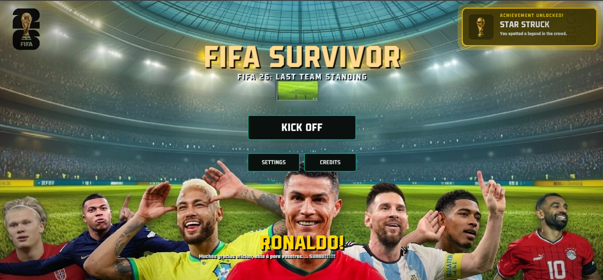
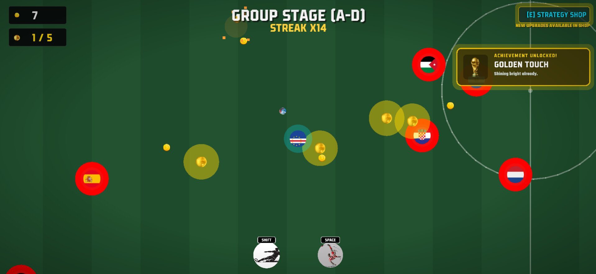

# FIFA Survivor
### FIFA 26: Last Team Standing

**A competitive arcade survival game, built solo for BUCC R&D at the Club Fair, Summer 2026**

> Survive an endless-feeling World Cup of rival nations in this fast-paced arcade shooter. Dodge, dash, and outlast waves of scaling defenders, collect coins to unlock upgrades in the Strategy Room, push through ten tournament stages to the Final, and chase the #1 spot on a live global leaderboard backed by Firebase.

  

  

---

## Overview

Developed as a solo initiative for the **Research & Development Department** of BUCC (BRAC University Computer Club) for the Club Fair of Summer 2026, **FIFA Survivor** is a high-octane 2D web game built to test player reflexes and real-time strategic decision-making.

The core goal was to maximize **audience engagement**. Instead of a static single-player experience, the game has a cloud-synced global leaderboard. That turns it into a crowd-driven competition where attendees can try to dethrone the current high score on the show floor.

## Core Features

* **Live Global Leaderboard**: Uses Google Firestore to fetch and update the Top 5 players, with a personal rank shown after every run. Each player identity (name + tag) owns a single entry that is only updated when they beat their own best, so spamming "Try Again" never floods the board. Firestore security rules validate every write (shape, types, whole-number score, score cap, server-set timestamp, strict document IDs, no edits to other fields). Because the game runs in the browser, a determined cheater can still submit a fake value under the cap. See [Anti-cheat](#anti-cheat-honest-version) below.
* **Ten-Stage Tournament Run**: Progress from the Group Stage through the Round of 32, Round of 16, Quarter Finals, Semi Finals and the 3rd Place Play-off to the World Cup Final. Collect Golden Balls to advance (5 per stage number, then 50 in the Final to lift the trophy).
* **Dynamic Strategy Room (Shop)**: Balance risk and reward by spending coins on stat upgrades (Speed, Fire Rate, Magnet Radius) or saving up for one-time Endgame Tactics (Shotgun, Energy Shield, Piercing Ball). Spawning and enemies freeze while the shop is open.
* **Scaling Difficulty Engine**: Enemy spawn rates, speeds and tougher defender types escalate with every stage, including boss-tier rivals.
* **Signature Moves**: A slide-tackle dash that makes you invincible and cleaves through rivals, plus a Bicycle-Kick shockwave that hits everything around you. Both run on cooldowns.
* **Match Milestones**: An achievement system with 11 milestones, from your first kill to rare, hard-earned feats. Progress lasts for the browser session and resets with the saved profile.
* **Pick Your Nation**: Choose from 48 national teams, and your name, team and audio settings are remembered between visits.
* **Menu Easter Eggs**: Seven star-player hype clips are hidden on the menu screen for curious players to find.
* **Built for Any Screen**: On-screen touch controls (joystick and action buttons), a safe-area-aware layout, and an installable PWA shell (web app manifest) let the game play as well on a phone as on a booth monitor.
* **Polished UI/UX**: Loading sequence with real download progress, smooth scene transitions, pause menu, settings (music and SFX volume, mute, reset saved profile) and responsive scaling.

## Technology Stack

| Layer | Technology |
|---|---|
| Game Engine | [Kaboom.js](https://kaboomjs.com) 3000.1.17 (self-hosted in `vendor/`), 2D canvas rendering |
| Backend / Database | Firebase Firestore 10.14.1 (modular SDK, lazy-loaded), rules-validated writes |
| Languages | JavaScript (ES modules), HTML5, CSS3 |
| Deployment | Vercel, static site with no build step, plus security and cache headers in `vercel.json` |
| Distribution | Installable PWA (web app manifest and home-screen icons) |

## How to Play

| Action | Input |
|---|---|
| Move | `W A S D` or Arrow Keys / on-screen joystick |
| Shoot | Automatic target acquisition |
| Dash | `Shift` / on-screen DASH button (slide tackle, invincible while sliding) |
| Special Skill | `Space` for the Bicycle-Kick area shockwave |
| Strategy Room | `E` / on-screen SHOP button to open or close the upgrade shop |
| Pause | `Esc` |

**The objective:** survive the horde of national-team defenders, collect coins to build your economy, spend them wisely in the Strategy Room, collect Golden Balls to advance through all ten stages, win the Final, and dethrone the #1 player on the Global Leaderboard.

**Tip:** standing still for too long enrages nearby rivals, so keep moving.

## Local Installation (For Developers)

1. Clone this repository: `git clone https://github.com/<your-username>/FIFA-Survivor.git`
2. Open the directory in your preferred IDE (e.g., VS Code).
3. Serve it with any static server (needed because the game uses ES modules and canvas assets; `npx serve .` works fine). Opening `index.html` directly from disk will not work.
4. Firebase initializes automatically from `src/config.js`. To point the game at your own Firebase project, swap the `firebaseConfig` values there and publish `firestore.rules` to your project's Firestore console.
5. Game balance (costs, cooldowns, difficulty curve) lives in `src/balance.js`.

### Optional tools

* **Rebuild the sprite atlases** after changing any flag or small sprite: `python3 tools/build_atlases.py`
* **Leaderboard cleanup**: `src/leaderboard_cleanup/leaderboard_cleanup.html` is an admin-only page for scanning and deleting leaderboard documents. Run it locally only. It is excluded from the Vercel deploy by `.vercelignore`.

## Deploying to Vercel

This is a static site with no build step and no environment variables. Vercel auto-detects it on import. `.vercelignore` keeps the admin tool, the old prototype code, the rules file and large source images out of the deployment. After your first deploy:

1. Open `index.html` and replace the domain in the `og:image` / `twitter:image` meta tags with your real Vercel domain, so link previews (Discord, WhatsApp, X, etc.) show the screenshot correctly.
2. Paste `firestore.rules` into **Firebase Console → Firestore Database → Rules → Publish**. This is a separate, manual step; deploying to Vercel does not touch Firebase.
3. (Optional) Turn on **Web Analytics** for the project in the Vercel dashboard. The tracking script is already wired up in `index.html`.

## Anti-cheat (honest version)

* `firestore.rules` caps scores (5000 by default), requires whole numbers and a server-generated timestamp, locks the document shape, limits names to 1 to 12 characters without `[`, `]` or line breaks, forbids deleting or lowering scores, and rejects junk document IDs. **Publish it** (Firebase Console → Firestore → Rules). Deploying to Vercel does not.
* The game also rejects implausible scores client-side (too many points for the match duration) and strips `[ ]` and control characters from player names. This only stops casual tampering, since anyone can call the SDK from devtools.
* Set the `5000` cap in the rules to just above the best score a human can really reach.
* A browser game can't prove how it was played. Full protection means a small server endpoint (e.g. a Vercel function) that issues a run token at match start, checks score against elapsed time on its own clock, and writes with the Admin SDK while the rules say `allow write: if false`.

## Performance Notes

* Everything loads behind the loading bar. The bar follows real download progress, and assets are started in small staged batches so decoding doesn't stutter (`src/assets.js`, `src/scenes/loading.js`).
* Flags and small sprites are packed into two atlases, which avoids dozens of GPU texture uploads. Rebuild them with `python3 tools/build_atlases.py`.
* Menu and stadium backgrounds are served as WebP. Music is trimmed to seamless loops, since Kaboom fully decodes audio into RAM and long tracks are expensive on phones. Untrimmed originals are kept out of the deploy.
* Kaboom is self-hosted in `vendor/`, and Firebase is lazy-loaded as a modular ES module once the browser is idle, so it stays off the critical path. If Firebase can't load (offline, blocked network), the game still runs and falls back to a sample leaderboard.

## License

Released under the [MIT License](LICENSE). Free to use, modify, and build on, with attribution.

---

<i>Built with ⚽, ☕, and way too many playtesting sessions.</i>

